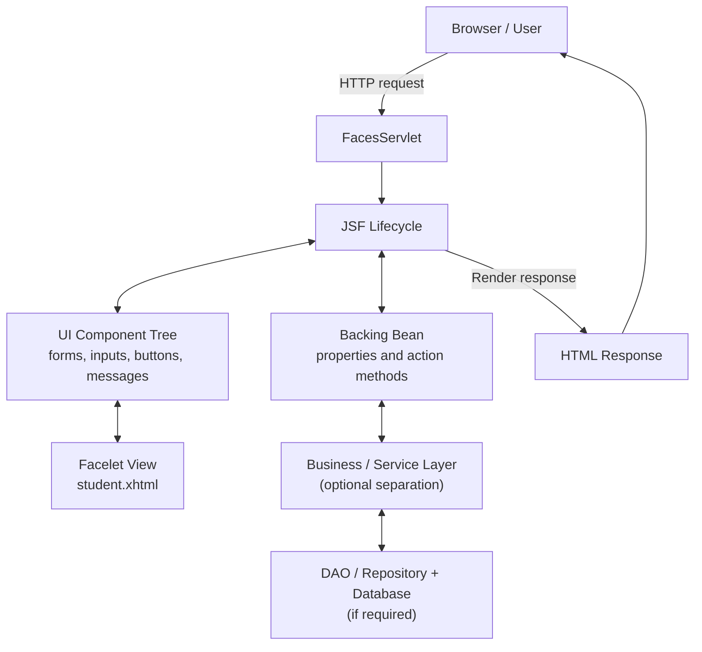
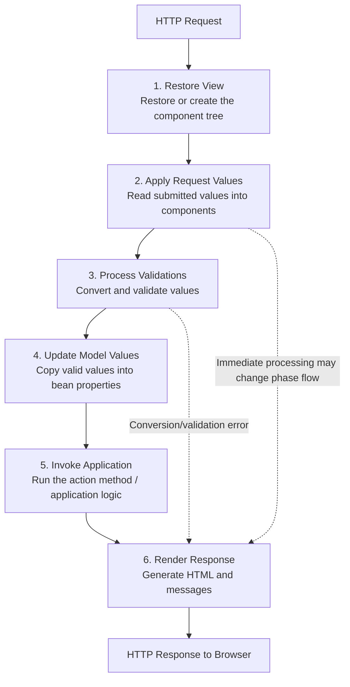

# JSF (Jakarta Faces): Architecture and Lifecycle

> **Purpose of these notes:** Understand what JSF is, how its architecture is organized, how one browser request travels through the JSF lifecycle, and how to explain both concepts using one small working example.

---

## 1. What is JSF?

**JSF (JavaServer Faces)** is a server-side Java web framework used to build user interfaces for web applications. Its modern name is **Jakarta Faces**.

Instead of manually writing all the code needed to read form fields, validate input, call Java logic, and update a page, a developer can use JSF components and let the framework coordinate much of that work.

For example, a login form may contain a text field, a password field, and a button. JSF connects those UI components to Java properties and methods, validates submitted values, invokes application logic, and renders the response.

### The main idea

**JSF connects a web page's UI components with Java application logic and manages the request-processing steps between them.**

JSF is especially useful for component-based, server-rendered web applications. It is not a replacement for Java itself, a database, or a web server.

### What problem does JSF solve?

Without a framework, a developer often has to manually:

1. Read submitted form values from the HTTP request.
2. Convert strings into the required Java data types.
3. Validate values and show error messages.
4. Call the appropriate Java method.
5. Decide which page to show next.
6. Generate the HTML response.

JSF provides a component model and a defined lifecycle to organize these tasks.

### JSF terminology

| Term | Meaning |
|---|---|
| **Jakarta Faces / JSF** | A Java framework for building component-based web interfaces. |
| **UI component** | A reusable interface element, such as a text field, button, or message. |
| **Facelet** | A view template, commonly an `.xhtml` file, used to describe a JSF page. |
| **Managed bean / backing bean** | A Java object that supplies data and actions to the page. In modern Jakarta Faces applications, CDI-managed beans are commonly used. |
| **Expression Language (EL)** | Expressions such as `#{studentBean.name}` that connect a page to Java properties or methods. |
| **FacesServlet** | The central servlet that receives JSF requests and coordinates the lifecycle. |
| **Renderer** | Converts component state into HTML for the browser and helps decode submitted request values. |
| **Navigation** | The process of deciding which view should be displayed next. |
| **Validator / converter** | A validator checks whether a value is acceptable; a converter changes values between text and Java types. |

> **Important:** JSF is a server-side framework. The browser displays the HTML that JSF generates; the browser does not directly execute the Java backing bean.

---

## 2. Where JSF fits in a Java web application

A typical Java web application may contain these parts:

- **Browser:** Displays the page and sends HTTP requests.
- **Web/application server:** Hosts the application and provides the servlet environment.
- **FacesServlet:** Receives JSF requests and starts the JSF lifecycle.
- **Facelet view:** Describes the page and its components.
- **Backing bean:** Holds page data and action methods.
- **Service / business layer:** Contains application rules, when the application needs a separate business layer.
- **DAO / repository and database:** Store and retrieve persistent information, when needed.

JSF does not require every application to have a database. The example later in these notes works without one.

---

## 3. JSF architecture

JSF uses a **component-based UI architecture**. A page is described as a tree of UI components. JSF manages that tree, processes incoming values, invokes actions, and renders the resulting view.

### Architecture diagram

The following Mermaid diagram can be rendered visually by Mermaid-compatible Markdown viewers, including supported GitHub views.



### How to explain the architecture

1. The user opens a JSF page in a browser.
2. The request reaches the web application and is handled by `FacesServlet`.
3. JSF builds or restores the view and its **component tree**.
4. During request processing, components and the lifecycle work with submitted values, converters, validators, and application actions.
5. The backing bean provides data and methods to the page.
6. If the application needs business logic or stored data, the bean can call a service and repository/DAO layer.
7. JSF renders the view as HTML and sends the response to the browser.

The arrows in the diagram show the main relationships, not a promise that every layer is called on every request. For example, a page that only displays a greeting may not use a database.

### What is the component tree?

Imagine a form with:

- one text field for a student's name,
- one button,
- one message area.

JSF represents those interface elements as UI component objects in a tree. During a postback, JSF can use that tree to identify submitted fields, validate them, update bean properties, and render messages.

The component tree is a central difference between JSF and a page that is treated only as static HTML.

### MVC relationship

JSF is commonly explained using **Model–View–Controller (MVC)** ideas:

| MVC part | Typical JSF role |
|---|---|
| **Model** | Application data and business objects; a backing bean may expose view-related data. |
| **View** | Facelet page such as `student.xhtml`. |
| **Controller** | `FacesServlet` and the JSF request-processing machinery. |

This is a useful teaching model, but the mapping is not perfectly one-to-one in every application. A well-structured application normally keeps substantial business rules in a service/model layer rather than putting everything in a page bean.

---

## 4. What is the JSF lifecycle?

The **JSF lifecycle** is the ordered sequence of phases used to process a JSF request and produce a response.

A request may be:

- **Initial request:** The user opens a page for the first time.
- **Postback:** The user submits a JSF form or interacts with a JSF component, sending a request back to the same application.

The full lifecycle is especially visible on a postback, such as submitting the student form in the example.

## 5. JSF lifecycle diagram



**Memory aid:** **Restore → Apply → Validate → Update → Invoke → Render**

The diagram shows the normal path. Some requests take a shorter path—for example, a conversion or validation error normally skips model update and the action method and goes to rendering so that the page can display an error. Features such as `immediate="true"` can change when certain events are processed.

---

## 6. The six lifecycle phases in depth

### Phase 1 — Restore View

**Question to ask students:** “Which page and component tree are we processing?”

JSF identifies the view being requested and restores its component tree from the saved view state, or creates a new tree for an initial request.

- On the first visit, JSF creates the view.
- On a postback, JSF restores the view associated with the submitted form.
- The view contains components such as input fields, buttons, and messages.

**Example:** JSF creates or restores the component tree for `student.xhtml`.

### Phase 2 — Apply Request Values

**Question:** “What values did the user submit?”

JSF reads request parameters and lets the relevant UI components decode them. Components keep submitted values at this stage.

Suppose the user submits the name `Aarav`. JSF reads the submitted text and associates it with the name input component.

**Important distinction:** At this stage, the value has not necessarily been copied into the backing bean's `name` property.

### Phase 3 — Process Validations

**Question:** “Can the submitted values be accepted?”

JSF performs conversion and validation:

- **Conversion:** Changes a submitted string into the required Java type, such as converting `"20"` to an integer.
- **Validation:** Checks whether the converted value satisfies rules, such as “required” or a permitted range.

If conversion or validation fails, JSF records an error message and normally proceeds to **Render Response**. It does not normally update the bean model or invoke the form's action method for that failed submission.

**Example:** If the name field is required and the user submits it empty, JSF reports a validation error and redisplays the form.

### Phase 4 — Update Model Values

**Question:** “The values are valid; where should they be stored?”

JSF copies the validated and converted component values into the properties referenced by the page's value expressions.

For example:

`#{studentBean.name}`

connects the input component to the `name` property of `studentBean`. Once this phase succeeds, the submitted name is available in that bean property.

### Phase 5 — Invoke Application

**Question:** “Now that the data is valid and stored, what should the application do?”

JSF invokes the action method associated with the submitted command component, unless an earlier error or a special processing rule prevents it.

The action method may:

- perform a calculation,
- call a service,
- save data,
- return a navigation outcome.

**Example:** The `submit()` method creates a greeting from the student's name and returns a navigation outcome.

### Phase 6 — Render Response

**Question:** “What should the browser see now?”

JSF renders the component tree into a response, usually HTML, and sends it to the browser.

This phase can occur after a successful action or after validation errors. JSF can render the same form with messages or render a view reflecting updated bean values.

**Example:** The browser receives the page showing `Welcome, Aarav!`.

### A crucial rule about validation errors

```text
Valid submission:
Restore View
    → Apply Request Values
    → Process Validations
    → Update Model Values
    → Invoke Application
    → Render Response

Invalid submission:
Restore View
    → Apply Request Values
    → Process Validations (error)
    → Render Response with error message
```

The invalid path normally does **not** proceed through Update Model Values or Invoke Application. This is one of the most useful lifecycle facts for exams and debugging.

---

## 7. One example to explain both architecture and lifecycle

We will use one small **Student Greeting** example. The user enters a name and clicks **Submit**. JSF validates the required field, stores the value in a Java bean, invokes one action method, and displays a greeting.

This single example is intentionally small so the same files can be used to explain both the architecture and the lifecycle.

### Example behavior

- Opening the page shows a name field and a Submit button.
- Submitting `Aarav` shows `Welcome, Aarav!`.
- Submitting an empty name shows a validation message instead of running the action successfully.

### Files used in this one example

```text
JSF application
└── src/main/
    ├── java/
    │   └── com/example/StudentBean.java
    └── webapp/
        └── student.xhtml
```

The example assumes a Jakarta Faces application is already configured in a compatible Jakarta EE web environment. The exact server setup and dependency versions depend on the Jakarta EE / Faces version being taught.

### Code: `StudentBean.java`

```java
package com.example;

import jakarta.enterprise.context.RequestScoped;
import jakarta.inject.Named;

@Named
@RequestScoped
public class StudentBean {

    private String name;
    private String message;

    public String submit() {
        message = "Welcome, " + name + "!";
        return null; // Stay on the same view
    }

    public String getName() {
        return name;
    }

    public void setName(String name) {
        this.name = name;
    }

    public String getMessage() {
        return message;
    }
}
```

### Code: `student.xhtml`

```xhtml
<!DOCTYPE html>
<html xmlns="http://www.w3.org/1999/xhtml"
      xmlns:h="jakarta.faces.html">
<h:head>
    <title>Student Greeting</title>
</h:head>
<h:body>
    <h2>Student Greeting Form</h2>

    <h:form>
        <h:outputLabel for="name" value="Enter your name: " />

        <h:inputText id="name"
                     value="#{studentBean.name}"
                     required="true"
                     requiredMessage="Please enter your name." />

        <h:message for="name" style="color: red" />

        <br />

        <h:commandButton value="Submit"
                         action="#{studentBean.submit}" />

        <h:messages />

        <h3>
            <h:outputText value="#{studentBean.message}" />
        </h3>
    </h:form>
</h:body>
</html>
```

**Compatibility note:** This example uses the modern `jakarta.*` namespace. Older Java EE / JSF tutorials may use `javax.*` and older XML namespaces. Do not mix `javax.faces.*` examples with a Jakarta Faces environment that expects `jakarta.faces.*`. A Jakarta EE-compatible server and the Faces implementation/dependencies must be configured for the page to run.

---

## 8. How to explain the example step by step in class

### Step A — Explain the architecture before running it

Point to each part:

1. **`student.xhtml`** is the View. It defines the form, text field, button, and message components.
2. **`FacesServlet`** is the entry point for JSF requests. The server's JSF configuration maps the page request into JSF processing.
3. **The component tree** contains the input, command button, and message components.
4. **`StudentBean`** is the backing bean. It stores `name` and `message` and provides the `submit()` action.
5. **The browser** receives the HTML rendered by JSF.

There is no database in this example because a database is not necessary to demonstrate either architecture or lifecycle.

### Step B — Demonstrate the successful submission

Ask a student to enter `Aarav` and click Submit. Trace the request:

| Lifecycle phase | What happens in this example? |
|---|---|
| 1. Restore View | JSF restores the `student.xhtml` view and its components. |
| 2. Apply Request Values | JSF reads the submitted text `Aarav` from the input component. |
| 3. Process Validations | The required-field rule passes because the field is not empty. |
| 4. Update Model Values | JSF assigns `Aarav` to `studentBean.name` using the bean property setter. |
| 5. Invoke Application | JSF calls `studentBean.submit()`, which sets the greeting message. |
| 6. Render Response | JSF renders the form and the greeting `Welcome, Aarav!` as HTML. |

### Step C — Demonstrate a validation error

Submit the form with the name field empty.

1. JSF reads the submitted value.
2. The required-field validation fails.
3. JSF records the validation message.
4. JSF skips the normal model-update and application-action path.
5. JSF renders the form again with `Please enter your name.`

Ask students: **“Did the `submit()` action run on this invalid submission?”** In the normal lifecycle path, **no**. This demonstrates why validation happens before model update and action invocation.

---

## 9. Important concepts students should remember

### `#{studentBean.name}` — what does it mean?

This is an Expression Language (EL) value expression.

- `studentBean` is the bean name established by `@Named`.
- `name` refers to the bean property.
- When JSF needs to read the value, it uses the property getter.
- When JSF updates the model after successful validation, it uses the property setter.

The expression links a UI component to Java data; it is not a Java variable declaration.

### What does `@Named` do?

`@Named` gives the CDI bean an EL-accessible name. With the class name `StudentBean`, the default name is `studentBean`, which is used in `#{studentBean.name}`.

### What does `@RequestScoped` mean?

The bean's lifetime is one HTTP request. A postback is another request, so a request-scoped bean is recreated for that request. JSF's submitted component state and lifecycle are still responsible for processing the submitted form. For larger multi-request workflows, choose a scope that matches the application's requirements.

### What does `action="#{studentBean.submit}"` mean?

It tells JSF which bean action method to invoke when the command button is processed successfully. The method returns `null`, which means stay on the current view in this example.

### What is the difference between a converter and a validator?

- A **converter** changes representation, such as text `"25"` into an integer value `25`.
- A **validator** checks whether a value is acceptable, such as whether a field is required or a number is within an allowed range.

A conversion or validation failure prevents the normal progression to model update and application invocation for that submission.

### Does every JSF request go through all six phases?

The six phases describe the standard lifecycle, especially for a normal form postback. The exact route can vary for an initial request, validation/conversion failures, immediate components, and other special cases. Teach the six-phase sequence first, then explain these exceptions.

---

## 10. JSF advantages and limitations

### Advantages

- **Component reuse:** Standard UI components can be reused across pages.
- **Form processing:** Conversion, validation, and messages are integrated into the framework.
- **Java integration:** UI components can connect to Java bean properties and methods.
- **Lifecycle structure:** Request processing follows a defined sequence, making it easier to reason about form submission.
- **Server-side rendering:** The server generates the HTML response.

### Limitations

- It is primarily a server-side, component-oriented approach, which may not fit every modern frontend architecture.
- Understanding the component tree and lifecycle takes practice.
- Poorly structured applications can place too much logic in backing beans.
- Version compatibility matters: Java EE-era `javax.*` code and Jakarta-era `jakarta.*` code are not interchangeable without migration.

---

## 11. Quick revision / exam answer

**JSF (JavaServer Faces), now Jakarta Faces, is a server-side Java web framework for developing component-based user interfaces.** A Facelet view defines UI components, a backing bean supplies data and action methods, and `FacesServlet` coordinates request processing. JSF commonly follows MVC principles: the view is the Facelet page, the controller role is handled by the servlet and lifecycle machinery, and the model/business logic supplies application data.

The six standard lifecycle phases are:

1. Restore View
2. Apply Request Values
3. Process Validations
4. Update Model Values
5. Invoke Application
6. Render Response

During a normal form submission, JSF reads submitted values, converts and validates them, updates bean properties, invokes the action method, and renders the response. If validation fails, JSF normally skips model update and action invocation and renders the page with error messages.

### One-line memory trick

**Restore the page → Read the input → Validate it → Store it → Run the action → Show the result.**
